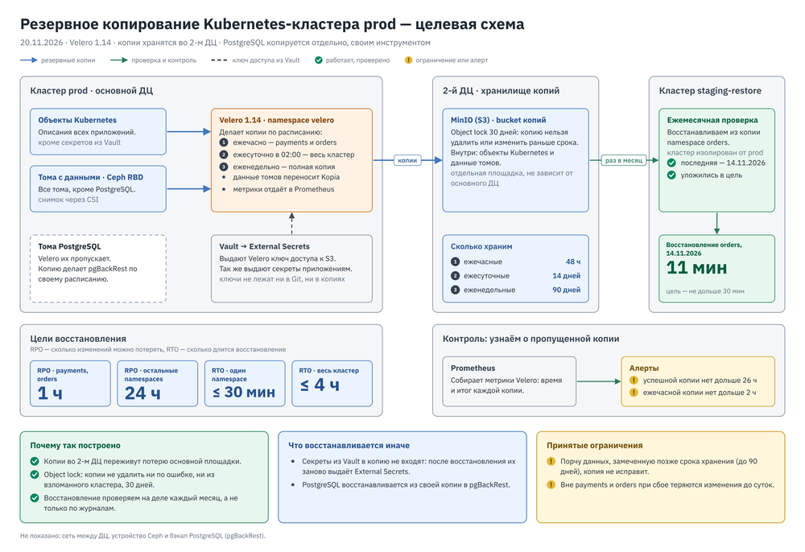

# meklon_skills

Коллекция плагинов Claude Code.

Репозиторий — это **маркетплейс** `meklon-skills` (монорепо): один
`marketplace.json` в корне перечисляет все плагины, каждый плагин лежит в
`plugins/<name>/`. Маркетплейс подключается один раз, дальше ставятся нужные
плагины.

| Плагин | Когда срабатывает | Что даёт |
|---|---|---|
| [`diagrams`](plugins/diagrams/README.md) | Нужна схема, статус-борд, роадмап или разбор для отчёта/клиента | Статичные PNG/SVG в едином стиле: три темы, линтер перекрытий и проверка контраста; примеры — в README плагина |



## Быстрый старт

Выполнить в Claude Code:

```
/plugin marketplace add meklon/meklon_skills
/plugin install diagrams@meklon-skills
```

## Обновление

```
/plugin marketplace update meklon-skills
/reload-plugins
```

Первая команда подтягивает свежий `marketplace.json` и плагины из репозитория,
вторая перезагружает их в текущей сессии без перезапуска Claude Code.

## Устройство репозитория

```
.claude-plugin/marketplace.json     # список плагинов маркетплейса
plugins/<name>/.claude-plugin/plugin.json
plugins/<name>/skills/<skill>/SKILL.md
plugins/<name>/README.md            # описание и примеры плагина
```

Новый плагин — папка в `plugins/` и запись в `marketplace.json`; версия — в
`plugin.json`, поднимать при изменениях, чтобы `marketplace update` их подхватил.
