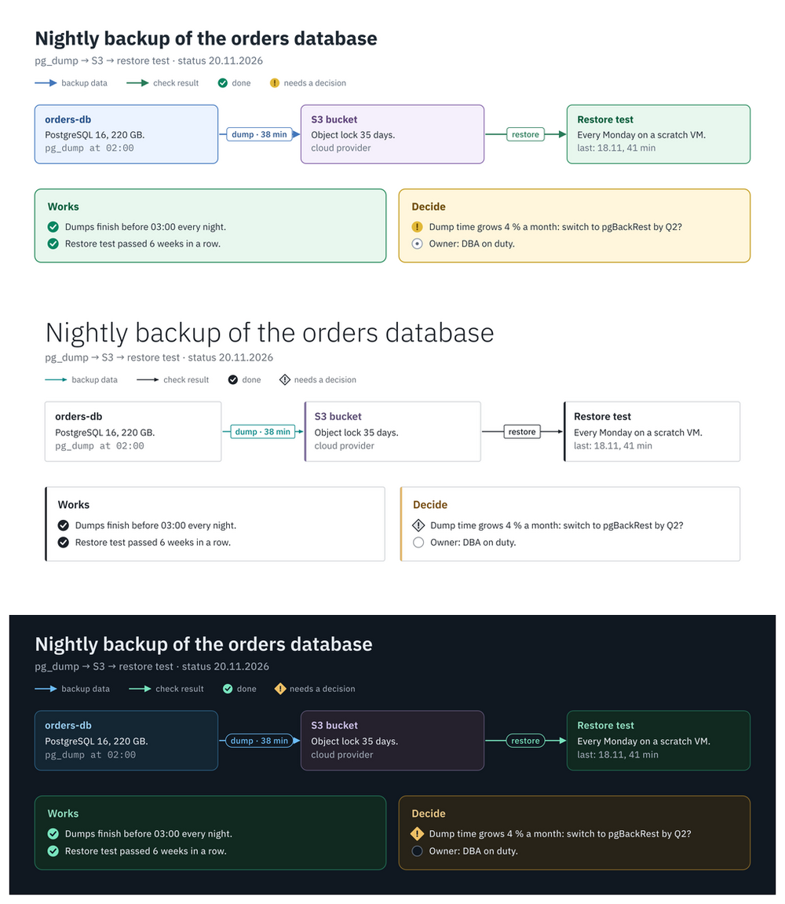
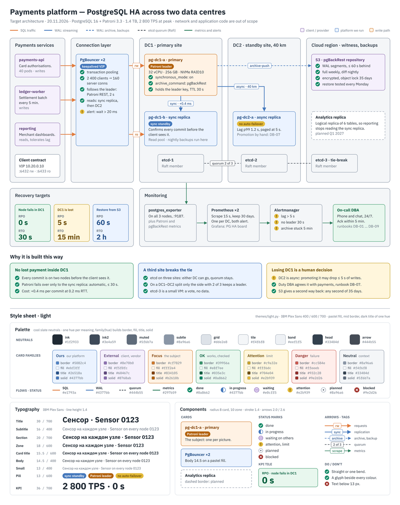
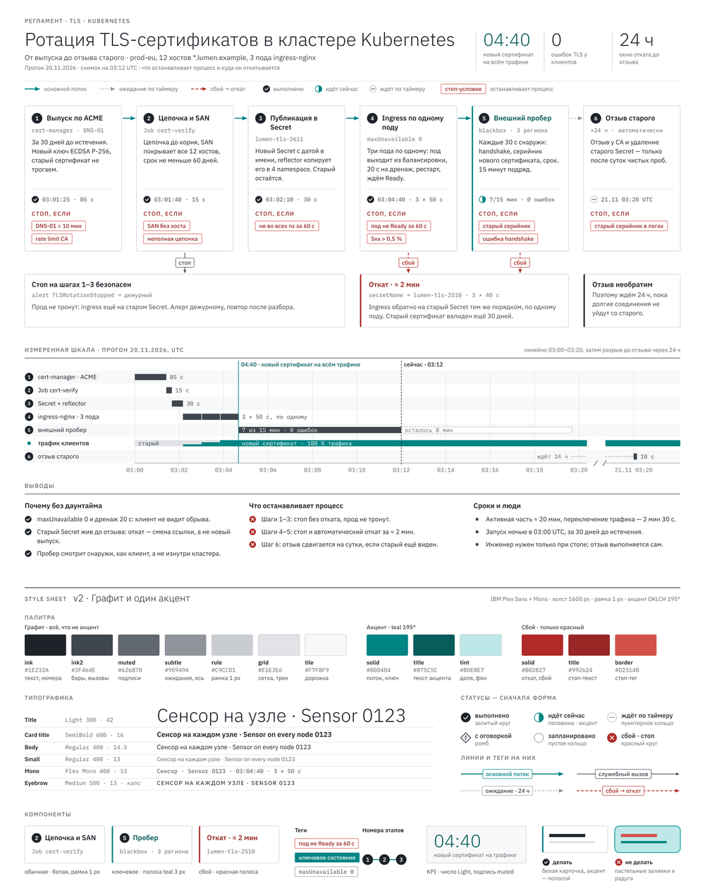

# diagrams — инженерные иллюстрации

Скилл `illustration`: статичные PNG/SVG для отчётов, задач в трекере, писем клиенту и
слайдов — архитектура, процесс по шагам, статус-борд, роадмап/гант, разбор
инцидента. Агент рисует Python-скриптом на ките из `skills/illustration/scripts/`
и сам проверяет результат: линтер вёрстки (перекрытия подписей, текст вне блока,
стрелка сквозь блок, мелкий кегль в превью 1000 px, висячие слова) и проверка
палитры (контраст WCAG, цветослепота, печать в сером).

```
/plugin marketplace add meklon/meklon_skills
/plugin install diagrams@meklon-skills
```

Просить обычными словами: «нарисуй схему бэкапа для отчёта», «сделай статус-борд
по миграции», «картинку к разбору инцидента». Перед рисованием агент спросит, чем
рисовать: **Opus** (≈ $3–4, ~6 мин, полнее и аккуратнее) или **Sonnet** (≈ $0.5,
1–2 мин, проще). Рисует субагент — основная сессия не забивается картинками.

## Пример

Целевая схема резервного копирования (по списку фактов, Opus, тема `light`):


## Три темы

`light` — по умолчанию; `graphite` — когда цветных смыслов мало и нужно вести
взгляд по главному потоку; `night` — для слайдов и созвонов. Другую тему агент
может предложить, но рисует в ней только после «да».



## Листы стилей

Полные образцы каждой темы — рабочая иллюстрация и под ней палитра, типографика
и компоненты:

| light | graphite | night |
|---|---|---|
|  |  |  |

## Что внутри

| Путь | Что |
|---|---|
| `skills/illustration/SKILL.md` | как агент работает: кто рисует, цикл «рендер → линтер → превью», стилистика, пороги, чеклист |
| `skills/illustration/scripts/kit.py` | SVG-кит: раскладка, карточки, стрелки с тегами, статусы, KPI, таблицы, шкала ганта; `write()` рендерит и проверяет |
| `skills/illustration/scripts/themes/` | темы `light`, `graphite`, `night`; своя — из пары тонов |
| `skills/illustration/scripts/layoutlint.py`, `palette_check.py`, `mpllint.py` | проверки вёрстки, палитры и графиков matplotlib |
| `skills/illustration/fonts/` | IBM Plex Sans / Mono (SIL OFL 1.1) |
| `skills/illustration/references/kit-api.md` | справка по API кита |

Нужен Python 3.10+ и Pillow. PNG рендерит первый найденный из resvg,
rsvg-convert, inkscape, cairosvg, headless Chrome; без них получится только SVG.
