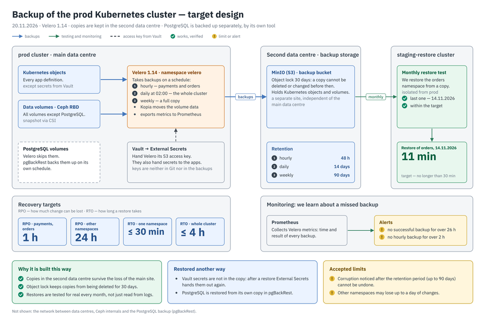
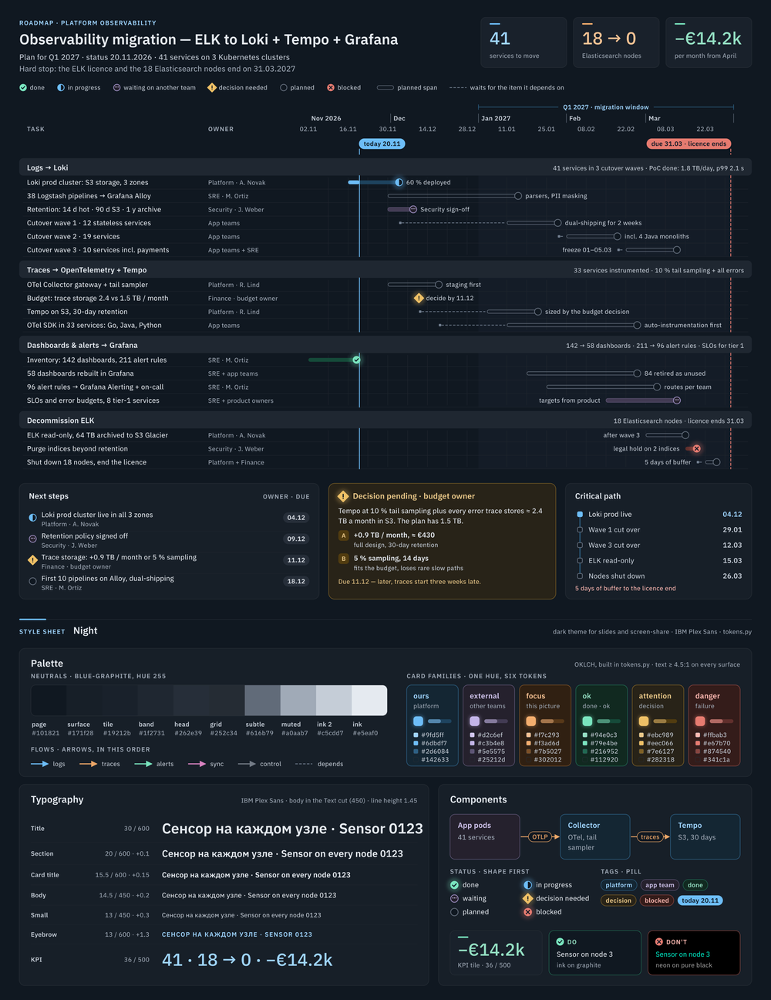

# diagrams — engineering illustrations

The `illustration` skill: static PNG/SVG pictures for reports, tickets, emails to
clients and slides — architecture, step-by-step processes, status boards,
roadmaps/gantt, incident write-ups. The agent draws with a Python script on the
kit in `skills/illustration/scripts/` and checks the result itself: a layout
linter (overlapping labels, text outside its box, arrows through boxes, type too
small in a 1000 px preview, orphan words) and a palette checker (WCAG contrast,
colour blindness, greyscale print).

```
/plugin marketplace add meklon/meklon_skills
/plugin install diagrams@meklon-skills
```

Ask in plain words: "draw the backup design for the report", "make a status
board for the migration", "a picture for the incident write-up". Before drawing,
the agent asks which model should draw: **Opus** (≈ $3–4, ~6 min, fuller and
neater) or **Sonnet** (≈ $0.5, 1–2 min, simpler). A subagent does the drawing, so
the main session is not flooded with images.

## Example

Target backup design, drawn from a list of facts (Opus, `light` theme):



## Three themes

`light` — the default; `graphite` — when there are few colour meanings and the
eye must follow the main flow; `night` — for slides and screen-shared calls. The
agent may propose another theme, but draws in it only after a "yes".


## Style sheets

A full sample of each theme — a working illustration with its palette,
typography and components below:

| light | graphite | night |
|---|---|---|
|  |  |  |

## What is inside

| Path | What |
|---|---|
| `skills/illustration/SKILL.md` | how the agent works: who draws, the render → lint → preview cycle, style, thresholds, checklist |
| `skills/illustration/scripts/kit.py` | the SVG kit: layout, cards, arrows with tags, statuses, KPIs, tables, gantt scale; `write()` renders and checks |
| `skills/illustration/scripts/themes/` | the `light`, `graphite`, `night` themes; a custom one from a couple of hues |
| `skills/illustration/scripts/layoutlint.py`, `palette_check.py`, `mpllint.py` | layout, palette and matplotlib checks |
| `skills/illustration/fonts/` | IBM Plex Sans / Mono (SIL OFL 1.1) |
| `skills/illustration/references/kit-api.md` | kit API reference |

Requires Python 3.10+ and Pillow. PNG is rendered by the first renderer found:
resvg, rsvg-convert, inkscape, cairosvg, headless Chrome; with none of them you
get the SVG only.

The code is MIT-licensed; the bundled IBM Plex fonts are under the SIL Open Font
License 1.1 (`skills/illustration/fonts/OFL.txt`).
